# LocalOTP · 2FA 账号管理

面向 Windows 与 macOS 上 Edge / Chrome 的本地 MV3 扩展，管理邮箱、密码与 TOTP 验证码，支持可选浏览器同步。

**1.6.0** 新增常驻小窗与画中画置顶、临时验证码折叠栏、带风险确认的短时免密。保留 CPAMP 配色、五套深浅主题与现有动画。

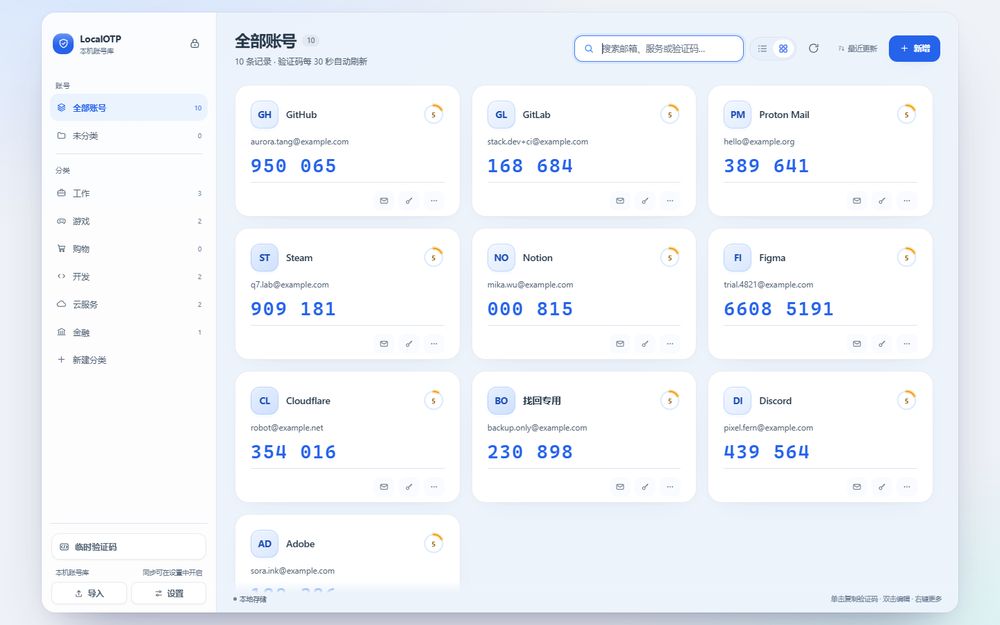

## 安装与更新

安装包下载：[GitHub Releases](https://github.com/UangSC/LocalOTP/releases/latest)。下载 ZIP 后先解压，再按下面步骤加载。

1. Edge 打开 `edge://extensions/`，Chrome 打开 `chrome://extensions/`，开启开发者模式。
2. “加载解压缩的扩展”选择本项目目录；使用发布 ZIP 时先解压，选择直接包含 `manifest.json` 的目录。
3. 已安装的用户点击原扩展上的“重新加载”，然后关闭并重新打开管理页/弹窗。无需移除扩展、清空账号或重设管理密码。
4. 新装默认“天空蓝”；已有配色会保留，可在设置中选择“天空蓝”体验 CPAMP 配色。

兼容目标为 Chromium 111+（推荐当前稳定版）。已实测 Windows Edge；macOS 的 Command 快捷键和平台分支已验证，尚未做 Mac 真机验收。Safari 需要独立转换，不在本包直接安装范围内。

管理密码是界面门禁，**不加密账号库**。详细边界与本次 **403 项**测试结果见 [1.6.0 验证记录](docs/validation-1.6.0.md)。沿用已有同步能力，不会把临时输入加入同步。

## 0. 三个页面，各有职责

| 页面 | 用途 |
| --- | --- |
| 小窗 `popup.html`（402 × 600） | 临时验证码 + 已保存账号快速复制；每行保留邮箱、密码、验证码三个按钮 |
| 管理页 `index.html` | 分类、列表/卡片视图、导入、备份、同步与外观设置 |
| 独立页 `api.html` | 无需保存账号的临时 OTP 验证；URL 输入、高级参数、实时倒计时和复制 |

地址栏输入 `otp`，按 Tab 或空格进入 LocalOTP，再粘贴 OTP 密钥并回车。也可从设置复制本机入口地址，追加 `#otp=密钥`。详见 [URL 接口、参数与隐私说明](docs/otp-api.md)。这是本地页面接口，不是 HTTP 服务。

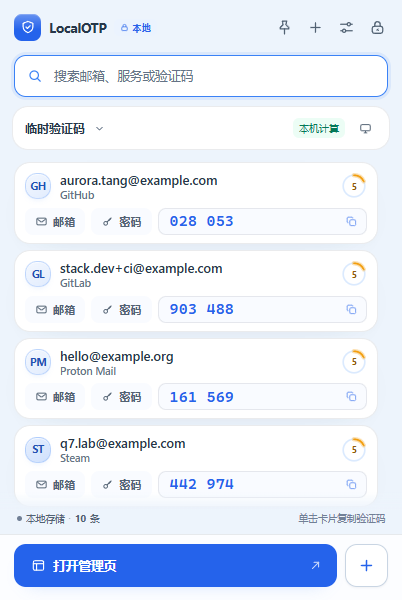

### 置顶与短时免密

- 点击右上角图钉打开常驻小窗，再次点击可进入浏览器画中画置顶。常驻窗口与系统置顶是两种状态；浏览器要求先有稳定宿主，再通过用户点击打开画中画。
- 临时验证码默认收起为一行，展开有动画；收起暂停计算，重新展开使用当前时间。
- 设置 → 访问门禁 → 短时免密，默认关闭。确认风险后可选 1 / 5 / 15 分钟；重开不续期，手动锁定与改密失效。
- [窗口与免密说明](docs/window-and-session.md) · [另一台浏览器如何拉取同步](docs/sync-guide.md)

### 0.1 三枚复制键

- **验证码键**占满剩余宽度、浅品牌底、等宽数字——它是一行里的主角；
- **邮箱 / 密码键**是带文字标签的实体按钮，不用悬停、不用猜；
- 点任意一枚 → **按钮就地变成「已复制」+ 勾**，不再弹一条 Toast 挡住列表；
- 点卡片空白处 = 复制验证码，波纹 + 整行泛光 + 带验证码的 Toast（要让你看清复制了什么）。

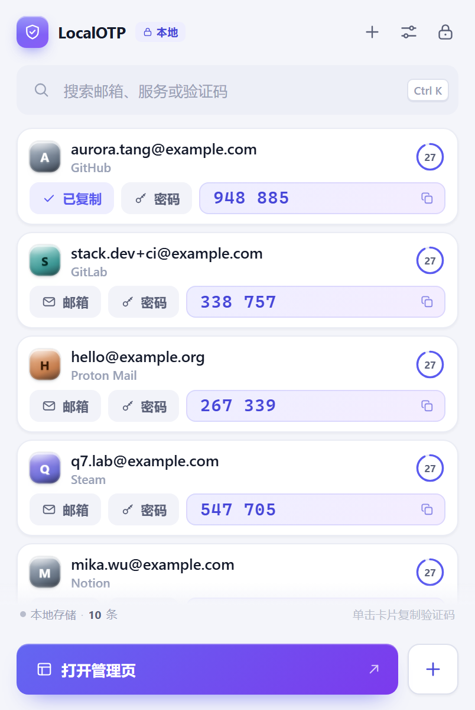

### 0.2 方形「＋」快速添加

底栏右侧那颗正方形按钮，点开是一张三行高的输入框：**一行一条**，
贴进去就解析、边打边校验（可添加 / 已存在 / 无效），
`添加 N 条` 只有在真有可加项时才亮。

- 分隔符除规范的 `----`，还认 `--`、Tab、`|`；
  **密码里含 `--` 时请用 `----`**（否则 `--` 会被当分隔符切错，界面里也写了这句）；
- 支持一次贴多行，同批次内重复自动跳过；
- 添加成功后新卡片滚到视口中央，并闪一圈品牌光。

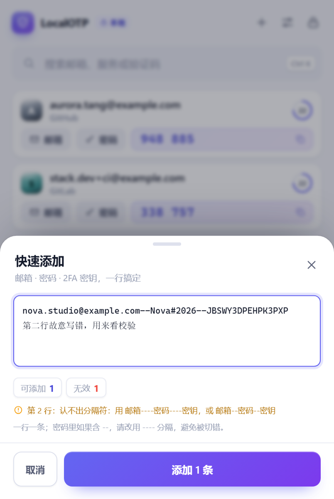

### 0.3 聚焦锁定

只盯一条抄的时候用：点卡片右上角的图钉（悬停出现）或按 `F`，
只有这一条保持全亮并微微抬起，**其余压到 14% 并去饱和**；
顶部浮出「◎ 服务名 ×」胶囊，再按 `F` / 点 × / 按 `Esc` 解除。
它和搜索聚光可以叠加，且**锁定优先**。

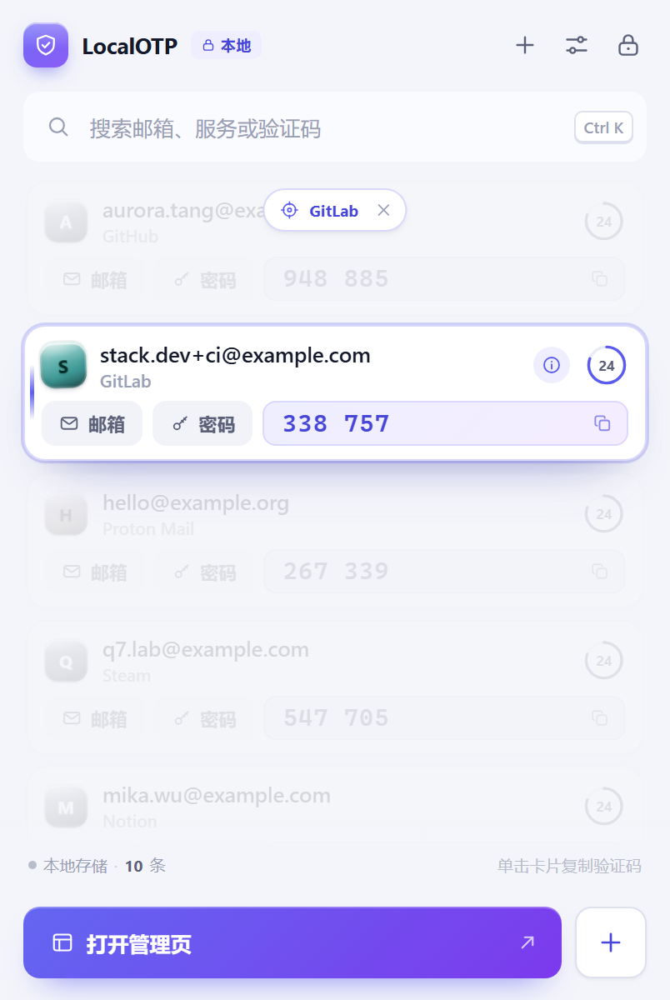

---

## 1. 快速开始

### A. 作为扩展加载（最接近真实）

1. `edge://extensions/` → 打开「开发人员模式」
2. 「加载解压缩的扩展」→ 选本目录
3. 点工具栏图标 = 弹窗（402 × 600）；「扩展选项」= 宽屏管理页

### B. 直接双击打开（最快，够验收界面）

双击 `index.html`（管理页）或 `popup.html`（弹窗）即可，**不需要起服务**：
两个页面都是普通 `<script src>` + 相对路径，没有 ES module、没有 fetch 本地文件。

首次进入要先设管理密码（≥ 4 位），**之后每次打开都要输入**——这是刻意的。

> **`file://` 下能验收到什么**：界面、动效、全部交互、真实验证码、
> 复制到剪贴板（`file:` 属于安全上下文，`navigator.clipboard` 可用，实测点击/直接调用都成功）、
> 两个页面共享同一份数据（同一个 `file://` 源，落在 `localStorage`）。
>
> **`file://` 下验不到什么**：`chrome.storage`（同步开关会**如实显示"当前环境不支持"**）、
> 扩展弹窗的真实 402×600 外壳。另外「双击预览」与「加载为扩展」是**两套独立存储**，
> 在预览里加的账号不会出现在扩展里，反之亦然。

### C. 本地静态服务（跑工具链 / 想用 http 源时）

```bash
node tools/serve.mjs 8787        # 本仓库自带的零依赖静态服务
# 或 python -m http.server 8787
# http://127.0.0.1:8787/popup.html
# http://127.0.0.1:8787/index.html
```

---

## 2. 这版到底改了什么

### 2.1 视觉：一套紫，两种深浅

原型的 2FA 是浅色紫 + 白卡片，2FA_2 是纯黑 + 薄荷绿。
合并版**采纳 2FA 的紫**作为唯一品牌色（`#5B5BF0 → #8B5CF6`），
把 2FA_2 的"发光 / 玻璃"效果降级为**只在必要时出现的光**：

- 平时：卡片是干净的白色面 + 1px 描边 + 极轻阴影
- 悬停：上浮 1px，阴影加大，**不换底色**
- 搜索命中：才出现品牌色描边 + 左侧光条 + 外发光
- 复制成功：整块面板泛一次品牌色光，620ms 后完全退干净

深色不是把浅色反相，而是重新排的一层：`#0C0E15 → #161A25`，
分段控件的滑块在深色下**比轨道更亮**（有"浮起"的方向感），
浅色下则是纯白滑块压在灰轨道上。

### 2.2 动效：三条曲线，四个时长

| 曲线 | 用途 |
| --- | --- |
| `cubic-bezier(.22,1,.36,1)` | 入场、抽屉、面板：起手快、收尾极慢 |
| `cubic-bezier(.34,1.32,.64,1)` | 按压回弹、滑块、Toast：一点点过冲 |
| `cubic-bezier(.65,0,.35,1)` | 呼吸、漂移等循环动效 |

时长只用 `110 / 180 / 280 / 420 / 660ms`。全部在 `prefers-reduced-motion` 下关闭。

### 2.3 交互：从 2FA_2 搬来并打磨的四处

1. **SVG 邮件 / 钥匙按钮**——小窗里升级成带文字的实体键（见 §0），
   大页面里保持 19px 迷你图标（服务名之后、更新时间之前），
   点一下**图标变成勾、泛起品牌色**，760ms 后还原，气泡提示同步变成「已复制」。
2. **复制回执**——整行泛光 + 验证码上跳 + 波纹 + Toast 带出验证码本体。
   回执画在 `::after` 覆盖层上，只动 `opacity / transform`，所以**结束后外观能干净地回到常态**。
3. **换码翻牌**——周期边界时验证码下落 + 模糊 + 回正，380ms。
4. **聚光搜索**——不隐藏任何一行，只把命中项提亮（描边 + 光条 + `<mark>` 荧光笔），
   其余压到 28% 不透明并去饱和。列表空间关系保持不变，你仍然知道"命中的那条在哪儿"。

### 2.4 设置面板：保留 2FA 的骨架，换成更细的控件

分组卡片 + 图标瓦片 + 右侧控件的结构保留，但把原型的 `<select>` 下拉
换成 **2FA_2 的分段滑块**（跟随系统 / 浅色 / 深色，1 / 5 / 15 / 关闭），
滑块位置按真实按钮宽度测量，文字长短不一时也严丝合缝。

面板内容按形态裁剪：小窗里没有"默认视图"这一项，因为小窗恒为快速复制行；
大页面才有列表 / 卡片的选择。


### 2.5 焦点样式：从"两层框"改成一圈光

之前点进输入框会同时看到**外层容器的紫色描边**和**输入框自己的 `:focus-visible` 外框**，
两圈套在一起，又脏又糙。现在：

- 输入框一律不再画外框（`outline: none`），焦点只由容器上一圈**边框 + 柔光**表达；
- 抽屉 / 对话框打开时会被程序化聚焦（为了键盘滚动），它们也不画焦点框；
- 浏览器只在**键盘 Tab** 到达按钮、链接、行时才画那圈 2px 外描边。

同一屏里任何可聚焦元素，任何时刻最多只有一层焦点提示。

### 2.6 大页面：补上表格的"骨架"

- 列表上方加了**列标题**（邮箱 / 服务 / 验证码），和行共用同一套栅格，左右边缘严格对齐；
- 行末加了 `⋯`（悬停出现）作为右键菜单之外的可发现入口；
- 服务名贴左，复制按钮与"更新于 …"排在列内右侧，形成可扫读的三段节奏；
- 卡片视图下自动隐藏列标题。

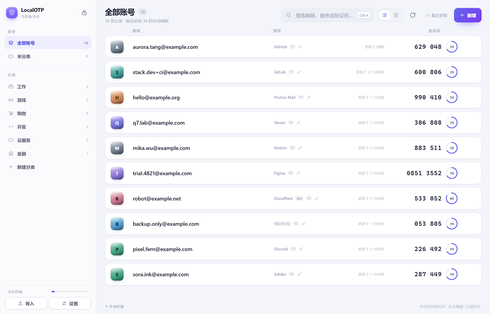

### 2.7 卡片材质与字母头像（1.3.0）

保留品牌紫，对照 `2FA_2` 的交互语言重新打磨材质：细边高光、轻微渐变、分层投影、
随指针移动的局部光晕、悬停浮起与按压回弹。管理页卡片使用更大的留白、清晰的服务名与验证码，
复制和更多操作收在独立的底部工具区。深色主题单独调整高光和文字对比度。

头像**只使用一到两个拉丁字母**，不使用图标、汉字或远程图片。优先服务名，中文服务名回退邮箱，
纯数字账号回退域名，完全没有字母时显示 `AC`。字母位于高光上层，不会被高光遮住。
头像恢复悬停轻微旋转和复制后的弹跳。

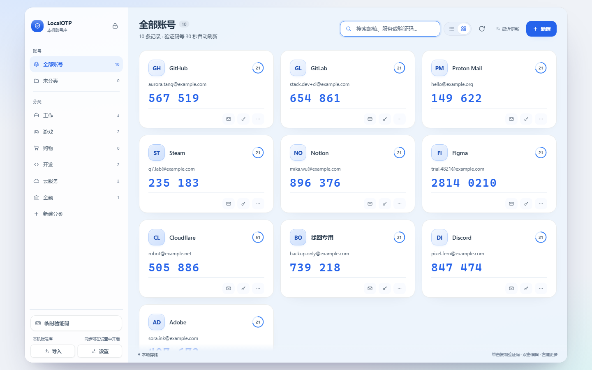

### 2.7.1 自定义下拉菜单（1.3.1）

账号编辑的分类选择使用自定义组合框：分类图标、紫色选中项、选中勾、浮层投影和展开动效。
支持上下方向键、Home/End、Enter、Esc、Tab 和文字前缀定位；Esc 先关闭选项，保留编辑抽屉。
菜单在抽屉之外定位以避免滚动裁切，空间不足时向上展开，长分类列表可滚动。
排序与更多操作菜单使用相同的材质和悬停样式。

`node tools/select-test.mjs` 验证实际鼠标与键盘操作、分类保存、深浅主题、弹窗边界和长列表。

### 2.7.2 五套色系与设置可读性（1.4.0）

「设置 → 外观 → 主题」下方新增色系：经典紫、清新绿、天空蓝、少女粉、黑白。
色系与浅色 / 深色 / 跟随系统独立，每套都有分别设计的浅深色画布、面层、品牌色和按钮前景。
黑白方案浅色使用黑主按钮，深色使用白主按钮；头像也转换为灰阶，状态提示仍保留语义颜色。

设置页修复了标题内层 span 被误染成浅灰的问题，标题用 500 字重，说明用 400，
优先以深色正文与高对比说明区分层级，不依赖全部加粗。
色系选择支持方向键、Home/End，并立即预览；随本机设置持久保存、同步到同一浏览器的其他页面，
不会写入跨设备账号同步负载。页面启动前读取色系镜像，避免先呈现默认紫色再切换。

完整验证与对比图见 [1.4.0 验证记录](docs/validation-1.4.0.md)。

### 2.7.3 随主题变化的字母头像（1.4.1）

头像不再按服务名绑定固定 RGB 调色板。服务名称只决定同色系内三档轻微明度变化，
背景、字色、边框、高光和阴影由当前色系与明暗主题实时计算；同一头像在绿色主题变为绿调，
粉色主题变为粉调，黑白主题保持灰阶。浅色使用柔和浅底与深字，深色使用低亮度底与亮字。

保留字母、悬停轻转和复制回弹；原有列表节点无需重建即可换色。设计参考和验证见
[1.4.1 头像说明](docs/validation-1.4.1.md)。

### 2.8 展示、切换与微交互

- 解锁入场：侧栏、表头与列表分层进入，条目向上浮起、轻微越过终点再回正。
- 列表 / 卡片切换：选择立即提交，旧可见内容 180ms 退场，新内容按对应账号位置做 520ms 过渡并逐项错峰。
- 分类切换复用同一动效调度；快速连点会取消旧动画和快照，以最后一次选择为准。
- 一次最多对 24 个可见条目运行动画；普通数据同步继续复用未变化节点，不重播整页入场。
- 刷新图标独立旋转 620ms，即使本地计算瞬间完成也能看见反馈；忙碌状态仍按真实任务状态释放。
- 搜索聚光、复制泛光、验证码换码、按钮按压等原有特效保留。

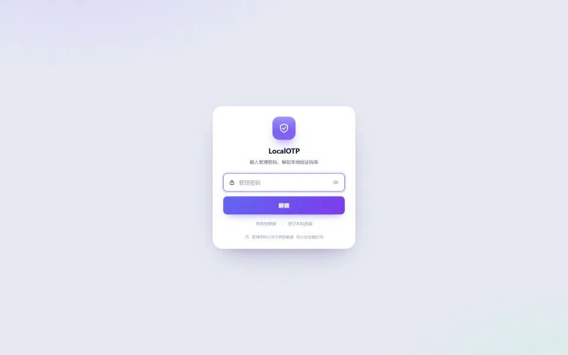

录制使用公开演示数据，并先完成一次往返以排除浏览器冷启动。它用于展示视觉衔接，不是帧率基准。

### 2.9 完整的锁屏与解锁形变

`js/gate-motion.js` 控制同一条 **680ms** 时间线：形变壳体保持可见，从登录卡尺寸展开到整页，
或从整页收缩回登录卡；真实页面用同步裁切显现，内容在达到最大尺寸前已经逐步进入。
不会在面板还没缩到终点时提前把整个壳体淡掉。

解锁先在环境背景下预绘制内容和动画图层，等待稳定出帧后启动（准备阶段有 600ms 上限）；
准备期间登录卡保持可见。锁屏在后段逐渐显现登录卡，收尾提交静态终态，不重新启用 CSS 入场动画。

此前的闪动根因：锁屏结束时恢复了 `.lock-card` 的 `animation`，使登录框从透明状态又入场一次。
1.3.0 通过连续 24 帧检查验证收尾时透明度为 1，位置和尺寸不再改变。
窗口缩放打断、页面隐藏和减少动态效果模式都走统一收尾，清除快照、临时层与交互锁。

首次解锁依然受浏览器初次绘制影响；完整测量与验证边界见 [1.3.0 验证记录](docs/validation-1.3.0.md)，
不以删掉动效换取固定 60 FPS 的承诺。

### 2.10 图标全部换成内联 SVG

界面里不再用字符当图标：＋、锁、齿轮、箭头、「更多」、
连键盘提示 `<kbd>` 里的 ↑ ↓ ↵ 都是内联 SVG（1.7–2.2 线宽，`currentColor`），
只有"文字"本身还是文字。分类图标也是 SVG，不加载任何外部资源或品牌 logo。

### 2.11 倒计时环为什么曾经"不同步"

弧长以前用的是**小数秒**的精确进度，而中间那个数字是 `Math.ceil` 取整的 ——
两者最多能差一整秒：数字还停在 26，弧其实已经走到 25.3 的位置了。
再加上最后 10 秒的呼吸动画在重渲染后会各自重新起跳，就更容易看成"各走各的"。

现在：

- **弧长 = 显示的那个整数秒 / 周期**，数字和弧永远对得上；
- 每秒**只写一次 DOM**，同一个 `Date.now()` 喂给所有环，中间交给 CSS 的 `1s linear` 过渡补间 ——
  既平滑又省，而且所有环共用同一条过渡时间线；
- 跨周期时 `snap` 瞬切回满格，不会反向扫一圈；
- 呼吸动画的相位从墙钟推出来（`--pulse-delay`），重渲染也不会各 pulse 各的。

> 唯一"应该不一样"的是 `robot@example.net`：它是 **60 秒周期**，弧长基数不同，数字和弧仍然自洽。

---

## 3. 功能一览

| 模块 | 行为 |
| --- | --- |
| 访问门禁 | 首次设置（两次输入 + 强度条）；之后每次打开都要解锁；错误抖动；**5 次失败冷却 20 秒**；闲置 1/5/15 分钟自动锁定（以最后交互为准，休眠恢复按真实时间判断） |
| 验证码 | RFC 6238（Web Crypto，SHA-1/256/512、6/8 位、1–86400 秒；编辑器常用选项为 30/60 秒）；**复制前按当前时间重算**，不会把刚过期的码写进剪贴板；≤2.5s 提示「即将刷新」；弧形进度与显示秒数**同源**（弧 = 秒/周期） |
| 小窗快速复制 | 每行三枚等高复制键（邮箱 / 密码 / 验证码）；点键即复制并把键变成「已复制」；点卡片空白复制验证码 |
| 快速添加 | 底栏方形「＋」：一行 `邮箱--密码--密钥`（也认 `----` / Tab / `|`）即插即用，多行一次贴入，边打边校验 |
| 聚焦锁定 | 图钉或 `F` 把某条钉住：只它全亮、其余压到 14%，顶部出现胶囊，`Esc` 解除 |
| 列表 / 卡片 | **大页面**的两种布局，**滑动开关点一下就切**，旧内容滑出、新内容滑入；列标题只在列表视图出现 |
| 刷新 | 工具栏圆形箭头：重算验证码与进度环（同步开启时先拉云端），图标转一圈 + Toast 回执 |
| 搜索 | 邮箱 / 服务 / 备注 / **验证码数字**；`↑↓` 在命中项间移动、`Enter` 复制、`Esc` 清空 |
| 新增 / 编辑 | 密钥合法时出现**实时预览**（真码 + 呼吸环）；高级参数（算法 / 位数 / 周期）折叠；一键生成 16 位随机密码；同一邮箱不允许重复 |
| 批量导入 | `邮箱----密码----密钥` 或 `otpauth://` 链接；粘贴 / 选文件 / 拖放；UTF-8 BOM、CRLF、空行、密码里含 `----` 都处理；四类计数 + 逐行原因 + 复制错误清单；重复项 **跳过 / 替换 / 保留** 三策略 |
| 分类 | 自定义名称 + 12 个内置 SVG 图标；宽屏页里是左侧导航；删分类只把账号移回「未分类」 |
| 备份 | 导出带版本号的 JSON（**不含管理密码摘要**）；导入按邮箱合并，不覆盖已有记录 |
| 同步 | `chrome.storage.sync`，账号与分类逐条合并，后台自动同步、保留删除记录、确定性冲突处理、失败重试与容量检查；单条仍受 8KB 上限约束 |
| 主题 | 跟随系统 / 浅色 / 深色；切换用 View Transitions 做一次整页交叉淡入；主题值镜像到 `localStorage`，**下次打开不会白闪** |

### 键盘

| 键 | 行为 |
| --- | --- |
| `/`、`Ctrl/⌘ K` | 聚焦搜索 |
| `↑ ↓` | 在命中项间移动（自动滚动跟随） |
| `Enter` | 复制当前项验证码 |
| `F` | 聚焦锁定 / 解除（作用于当前项），`Q` 快速添加 |
| `E` / `Delete` | 编辑 / 删除当前项（行获得焦点时） |
| `N` / `I` / `S` / `L` | 新增 / 导入 / 设置 / 锁定 |
| `Esc` | 退出聚焦锁定 → 关抽屉 → 关菜单 → 清搜索 |

---

## 4. 目录结构

```
Merge2FA/
├─ manifest.json            MV3：storage + clipboardWrite + alarms，无内容脚本
├─ popup.html               弹窗壳（402 × 600）
├─ index.html               宽屏管理页壳
├─ api.html                 临时验证码 URL 页面
├─ styles/
│  ├─ tokens.css            设计令牌：色 / 字 / 间距 / 圆角 / 缓动 / 双主题
│  ├─ base.css              重置、焦点、滚动条、关键帧、舞台与外壳
│  ├─ components.css        顶栏、搜索、行 / 卡片、倒计时环、迷你按钮、通用控件
│  ├─ overlays.css          锁屏、遮罩、抽屉、对话框、菜单、Toast、气泡、表单、导入、设置
│  ├─ color-schemes.css     五套浅深色系、设置文本层级与色系控件
│  ├─ finish.css            既有材质与微交互
│  ├─ studio.css            CPAMP 视觉覆盖层，不改既有动画时间线
│  ├─ otp-tools.css         临时组件与独立页面布局
│  └─ page.css              宽屏两栏布局（侧栏 + 列表），只在 data-surface="page" 生效
├─ js/
│  ├─ theme-boot.js         样式生效前同步定主题（防白闪）
│  ├─ util.js               DOM 构造、图标、剪贴板、格式化、缓动滚动、配色
│  ├─ totp.js               Base32 严格校验、HOTP/TOTP、otpauth:// 解析
│  ├─ otp-input.js          统一输入解析与 URL 契约
│  ├─ otp-session.js        绝对时间调度、并发防护与复制校验
│  ├─ otp-widget.js         弹窗 / 独立页共享临时组件
│  ├─ api.js                独立页面编排，不加载账号库
│  ├─ entry-boot.js         首次资源加载前清理 URL 参数
│  ├─ omnibox.js            地址栏关键字分发
│  ├─ seed.js               虚构演示账号与示例导入文本
│  ├─ store.js              状态、并发持久化、检索、导入解析、备份、摘要
│  ├─ sync.js               同步合并模型、配额校验与执行器
│  ├─ background.js         MV3 后台同步、会话与常驻窗口
│  ├─ access-service.js     后台门禁租约与一次性窗口票据
│  ├─ access.js             页面会话客户端，不保存密码
│  ├─ pin-window.js         常驻 / 画中画置顶
│  ├─ window-boot.js        读取消费窗口票据并清理 URL
│  ├─ gate-motion.js        门禁过渡时间线与清理
│  ├─ ui.js                 抽屉 / 对话框 / 菜单 / Toast / 气泡 / 波纹 / 倒计时环 / 分段控件
│  ├─ list.js               渲染、倒计时调度、聚光搜索、键盘活动项、复制回执
│  ├─ sheets.js             账号编辑、批量导入、设置、改密、分类管理
│  └─ app.js                编排：门禁、搜索、复制、筛选、主题、快捷键、备份
├─ assets/icons/            由 tools/make-icons.mjs 生成的品牌图标
├─ tools/
│  ├─ make-icons.mjs        纯 Node 图标生成（zlib + 超采样光栅化，无第三方依赖）
│  ├─ serve.mjs             零依赖静态服务（验收用，端口可传参）
│  ├─ selftest.mjs          模块级自检（98 项）
│  ├─ cdp.mjs               截图 / E2E / 性能探针共用的无头浏览器工具
│  ├─ shots.mjs             真实渲染截图
│  ├─ qa.mjs                端到端交互自检（82 项）
│  ├─ sync-test.mjs         多设备与多页面存储合并测试
│  ├─ extension-test.mjs    真实扩展后台与存储测试（隔离配置）
│  ├─ regression.mjs        实际鼠标命中、快速切换与动效回归
│  ├─ motion-review.mjs     中间帧截图与动画稳定性检查
│  ├─ motion-demo.mjs       实际浏览器动效录制
│  ├─ encode-motion.py      录制帧编码为动图（Pillow）
│  └─ perf.mjs              解锁展开动画的帧率探针
└─ docs/shots/              截图
```

---

## 5. 自检

1.6.0 本轮共 403 项检查通过，详见 [验证记录](docs/validation-1.6.0.md)。新增测试覆盖计算边界、异步竞态、真实剪贴板、临时密钥存储隔离和完整按钮命中。

```bash
node tools/make-icons.mjs     # 重新生成图标
node tools/selftest.mjs       # 模块级：98 项
node --test tools/access-test.mjs # 18 项会话、票据与安全边界
node tools/window-browser-test.mjs # 41 项真实窗口、折叠、风险确认和免密
node --test tools/otp-core-test.mjs # 16 个核心场景，含 180 组独立 HMAC 对照
node tools/otp-browser-test.mjs # 52 项真实 MV3 临时功能验收
node tools/select-test.mjs    # 自定义下拉菜单键盘、鼠标与滚动
node tools/qa.mjs             # 端到端：82 项（真实 Edge）
node tools/sync-test.mjs      # 多设备、离线删除、冲突和错误恢复
node tools/extension-test.mjs # 真实 MV3 后台与 storage.sync
node tools/regression.mjs     # 实际点击与连续锁屏解锁
node tools/avatar-test.mjs   # 头像十种组合、渐变对比度、原位换色
node tools/color-test.mjs    # 五色 × 两种主题、对比度、持久化和键盘
node tools/motion-review.mjs  # 动效中间帧、收尾稳定性与窗口缩放
node tools/perf.mjs           # 展开动画帧率（加 --sw 看软件光栅的最差情况）
node tools/shots.mjs          # 重新出图
```

`selftest.mjs` 把浏览器端的 IIFE 模块放进 Node 沙箱里**真实执行**，覆盖：

- RFC 4226 附录 D 的 10 个 HOTP 向量
- RFC 6238 附录 B 的 18 个 TOTP 向量（SHA-1 / SHA-256 / SHA-512 × 6 个时间点）
- Base32 边界：小写与空格规范化、填充位置、`% 8 == 1`、解码后不足 8 字节，
  以及一个容易误判的对照 —— `SHA256INVALID` 里没有 `0/1/8/9`，它其实**是合法 Base32**
- 导入解析：BOM、CRLF、密码含 `----`、密码首尾空格原样保留、同批重复只标后出现的、
  跨批重复、`otpauth://` 识别、非法密钥给出具体原因
- 快速添加：`--` / Tab / `|` / `----` 四种分隔、含 `--` 的密码、认不出分隔符时的原因
- 三种重复策略的写入结果、备份合并不重复写、检索区间、PBKDF2 摘要往返

`qa.mjs` 在真实 Edge 里跑完整交互：门禁（含 5 次失败冷却）、列表与倒计时、
搜索聚光、三枚复制键、快速添加、聚焦锁定、新增 / 校验 / 编辑、右键菜单删除、
分类筛选、主题、设置面板与分类管理、改密（旧密码失效）、备份负载、
宽屏登录卡尺寸与展开动画收尾、宽屏导航筛选。

---

## 6. 诚实边界

- **管理密码是界面门禁，不是加密。** 它用 PBKDF2-SHA256（210k 轮、随机盐）存摘要，
  比原型里的明文比对强，但它**不加密任何账号数据**，也不参与密钥派生。
  能读到扩展存储的人仍然能拿到明文账号。界面上所有文案都按这个口径写。
- **账号密码与 TOTP 密钥以未加密形式存放在扩展存储里**，密码隐藏只是防误看。
- **同步使用浏览器存储接口，但不是端到端加密**：写入 `chrome.storage.sync` 的内容会存在浏览器账号名下。
  管理密码摘要**只存本地**，不上云。
- **演示账号是虚构数据**，密钥都是公开示例（`JBSWY3DPEHPK3PXP` 之类），不要用于真实账号。
- 忘记管理密码没有找回途径，只能「清空本机数据」后重新导入备份——锁屏和设置里都写了这句。

---

## 7. 浏览器账号同步的使用方式

1. 在 `edge://extensions/` 重新加载本目录，版本应为 **1.6.0**。现有扩展直接点「重新加载」，不要为了更新先移除扩展。
2. 两台设备使用同一种浏览器、同一浏览器账号，开启浏览器同步中的扩展同步。
3. 两台设备必须有**相同扩展 ID**。商店发布的同一扩展天然一致；解压加载的 ID 可能随路径或配置改变，不能仅靠文件内容相同保证。
   手动开发部署应在分发前固定同一公开扩展 key；给已经使用中的扩展新增 key 可能改变 ID，需要先备份并规划迁移。
4. 在本扩展「设置 → 同步与备份」开启「浏览器同步」，首次会合并两端数据；可用「立即同步」重试。
5. 新增、编辑、删除、分类操作自动排队；弹窗关闭后由后台继续处理。失败时保留本地数据，并通过 alarm 定期重试。

同步范围：账号、分类、删除记录。主题、视图、自动锁定偏好和管理密码只在本机。
Edge 与 Chrome 的云端账号不互通。浏览器决定传输时机；API 写入成功表示已提交浏览器同步存储，
不能证明另一台设备已收到，也无法由扩展判断用户是否已登录云端账号。

存储限制约为总计 100KB、单条 8KB、512 个条目（包含分类和删除记录）。超限会显示具体错误，
不清空本地内容。为避免长期离线设备复活旧账号，删除记录不会在 30 天后自动丢弃。
同一记录并发修改按更新时间取较新值；时间相同采用确定性排序，只保留一个版本，重要修改请保留备份。

关闭同步保留两边已有数据，不清空云端。「清空本机数据」会先关闭同步，再清空本机；以后重新开启同步可能再次拉回云端记录。
所有设备应升级到本版后再继续编辑；旧版的分类与删除合并逻辑不完整。
首次安装的扩展从空库开始；普通 HTML 预览保留虚构演示数据。需要演示时可在设置中「恢复演示数据」。

本次已验证真实 Edge 扩展的后台运行、存储写入、变更监听与重开弹窗的数据恢复；
没有使用真实浏览器账号，**跨设备云端传输尚未实机验收**。

---

## 8. 还可以往哪走

| 目标 | 落点 |
| --- | --- |
| 真加密 | 在 `store.js` / `sync.js` 的读写边界加一层封装（PBKDF2 派生密钥 + AES-GCM），UI 不用动 |
| 二维码 | 已有 `totp.parseOtpauth()`，接一个 `<input capture>` 或 `BarcodeDetector` 即可 |
| 网页自动填充 | 需要 content script + 站点↔账号映射表，是唯一还没有的"减少步骤"能力 |
| 大列表 | 已验证 500 条完整渲染与节点复用；更大规模可引入窗口化渲染 |

---

## 附：界面一览

**小窗（浏览器工具栏里点开的那一屏）**

| | |
| --- | --- |
|  | 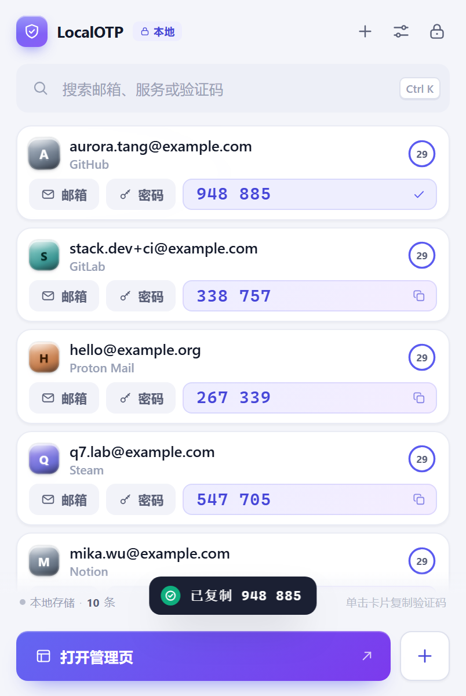 |
| 三枚复制键 + 倒计时环 + 方形「＋」 | 复制验证码：整行泛光 + Toast |
|  | 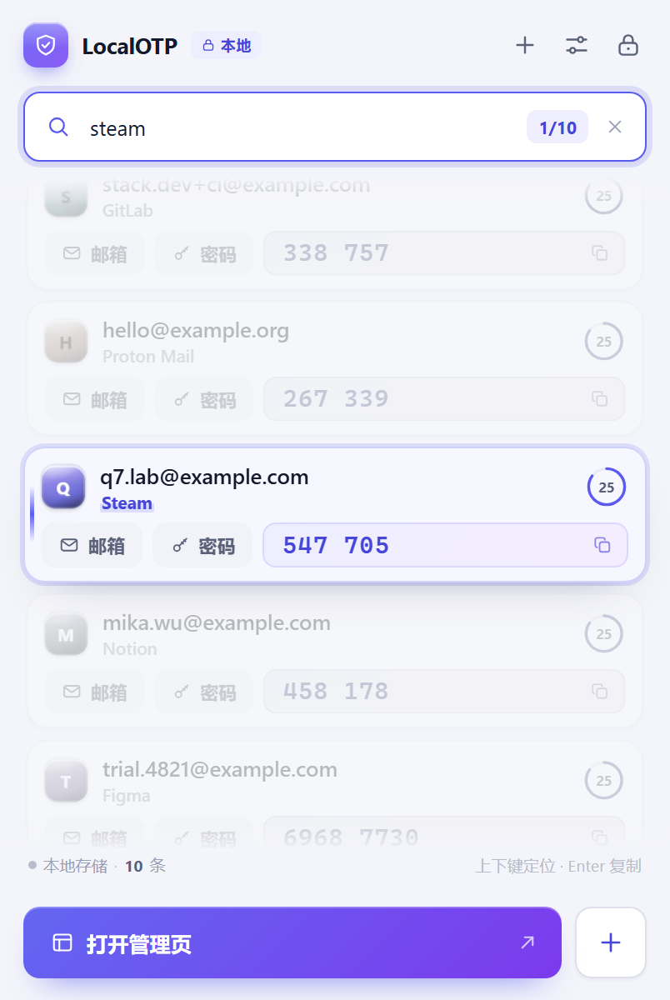 |
| 点「邮箱」：按钮就地变「已复制」 | 聚光搜索：命中提亮、其余压暗 |
|  |  |
| 聚焦锁定：只剩一条是亮的 | 快速添加：一行一条，边打边校验 |
| 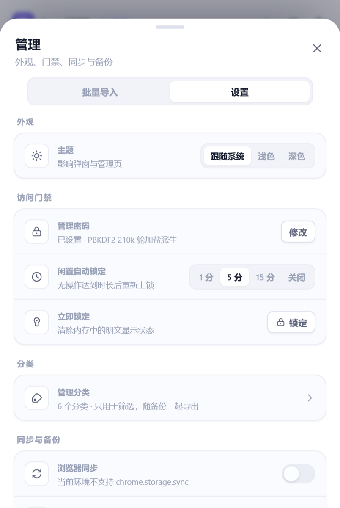 | 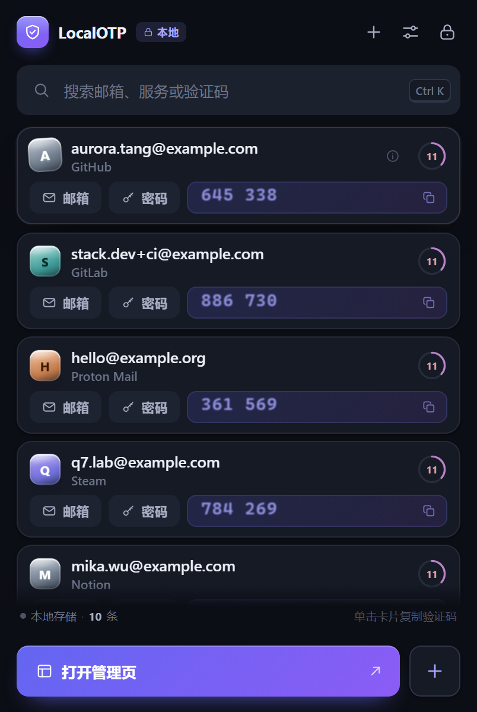 |
| 设置面板（小窗里没有"默认视图"） | 小窗 · 深色 |
| 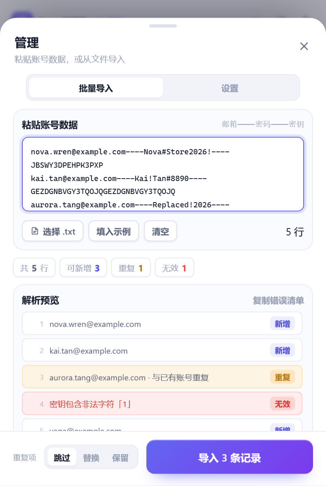 | 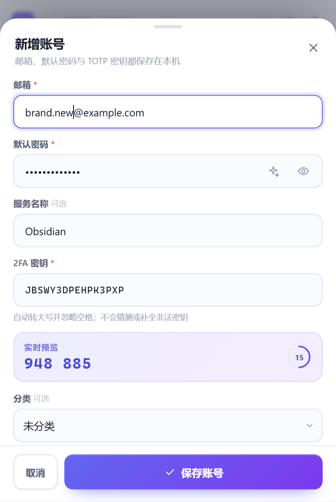 |
| 批量导入：四类计数 + 逐行原因 | 编辑：输入框聚焦只有一层光 |
|  | 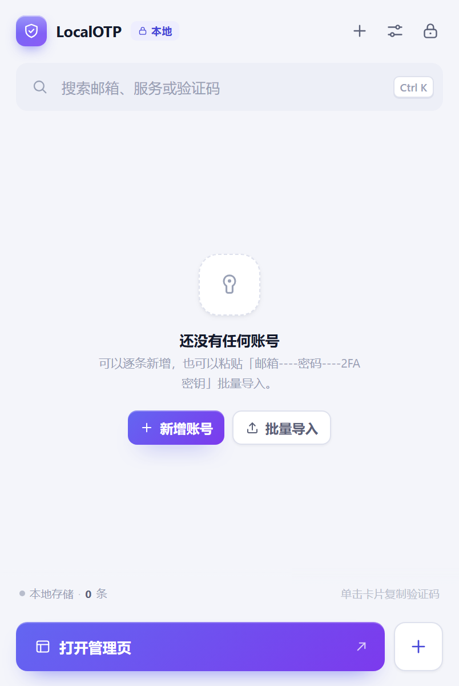 |
| 设置 · 深色 | 空状态 |
| 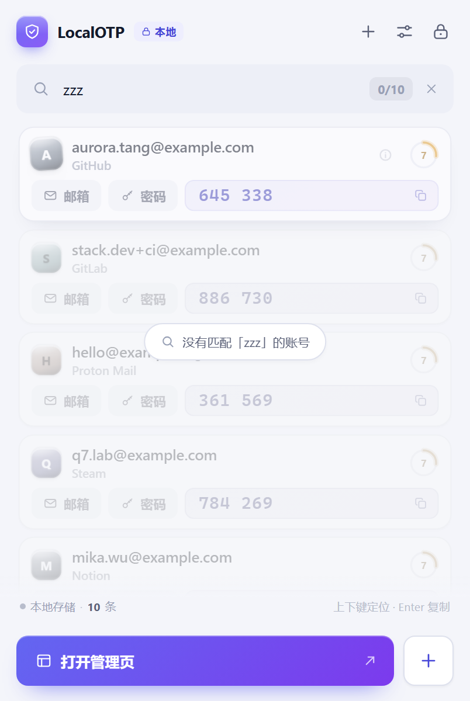 | 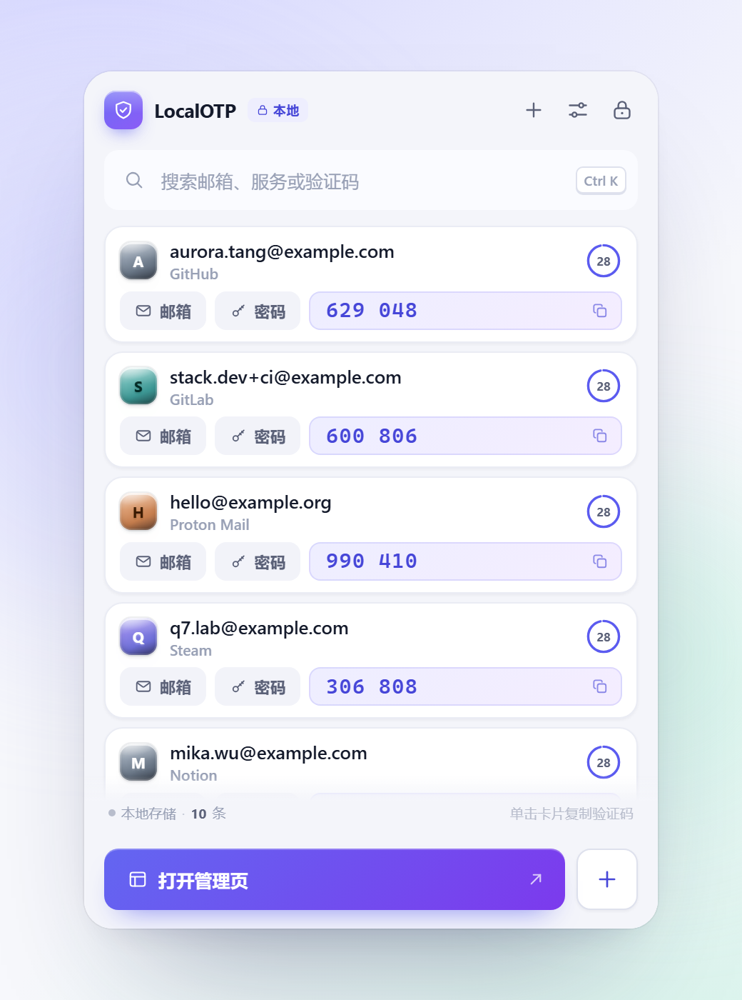 |
| 搜索无匹配 | 弹窗外壳与环境光 |

**大页面（扩展选项 / 管理页）**

| | |
| --- | --- |
| 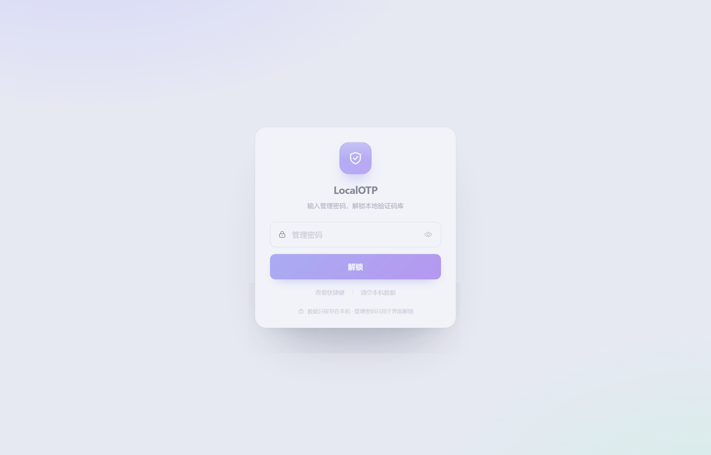 |  |
| 居中的小登录卡（不再是整屏）+ 展开动画 | 列表 + 列标题 + 「更新于」列 |
| 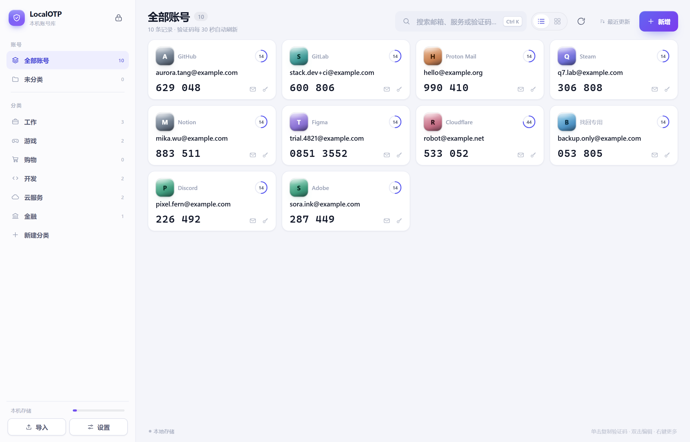 | 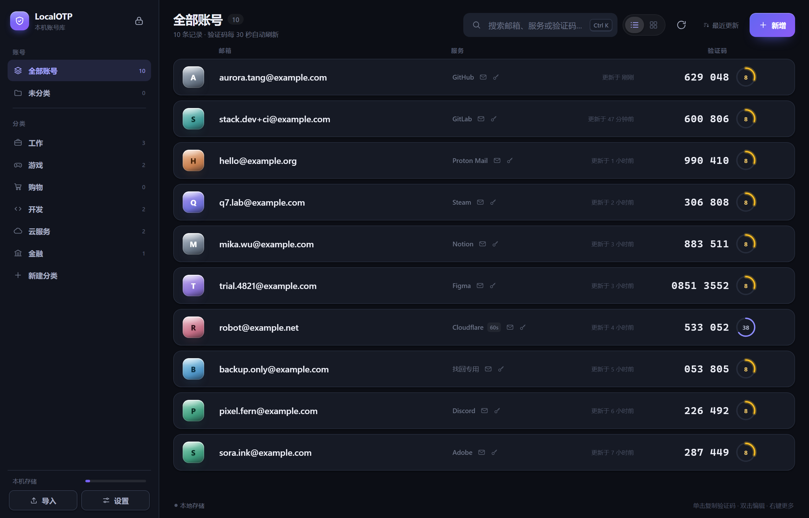 |
| 卡片视图（列标题自动隐藏） | 宽屏 · 深色 |
| 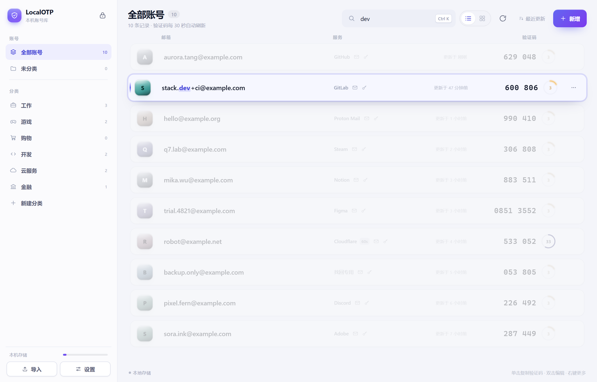 | 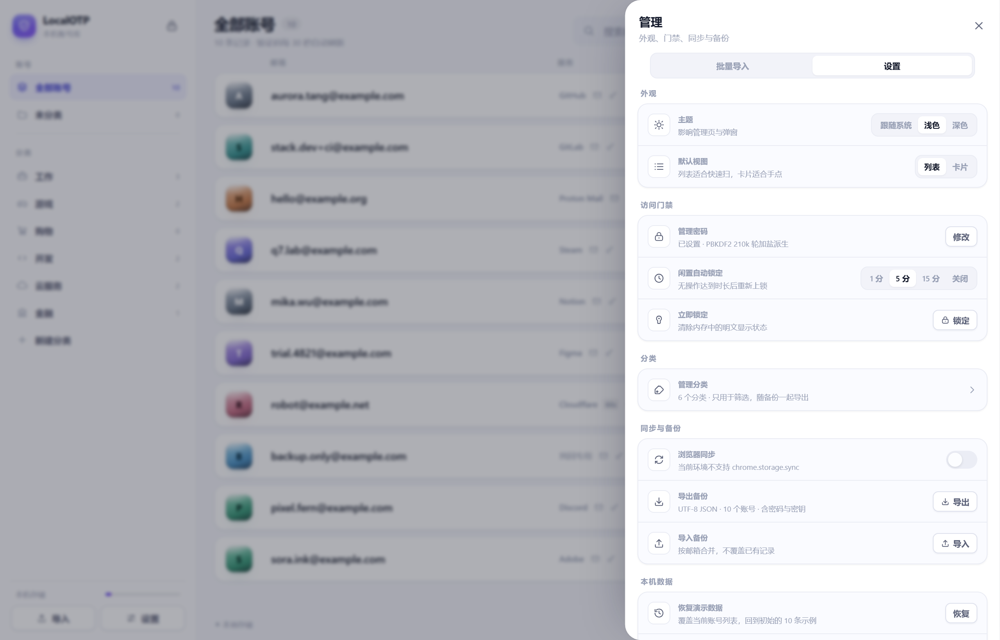 |
| 宽屏 · 聚光搜索 | 宽屏 · 设置侧栏 |


## 开发与打包

运行 `node tools/serve.mjs` 可预览三个页面，开发工具使用 Node 22+，没有第三方运行依赖。浏览器测试自动使用隔离的配置目录，不读取日常浏览器账号。性能测试请单独运行，避免并行浏览器负载干扰。

运行 `python tools/package.py` 生成 `dist/LocalOTP-1.6.0.zip`；仅包含运行资源和 API 说明，不包含截图、测试数据或本机配置。脚本仅使用 Python 标准库。
